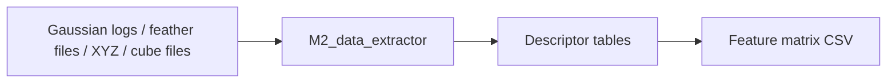
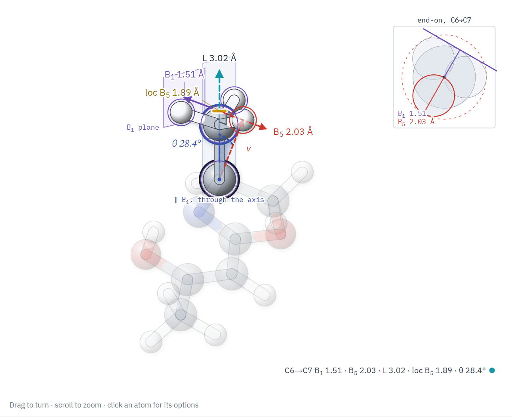
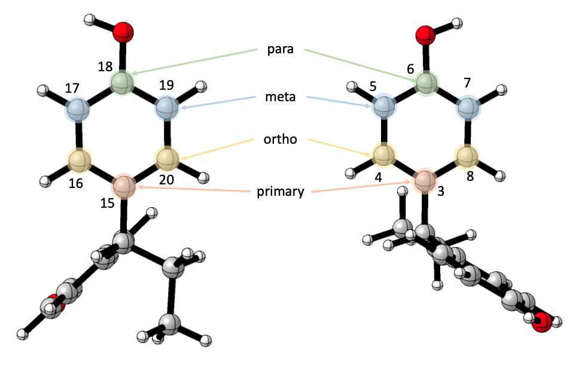
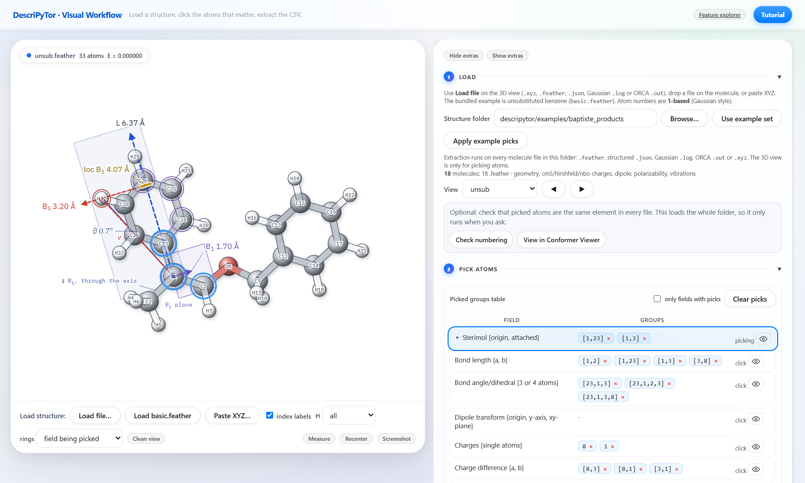
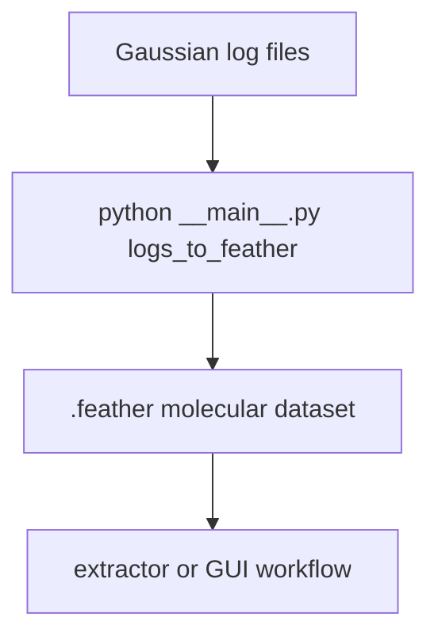
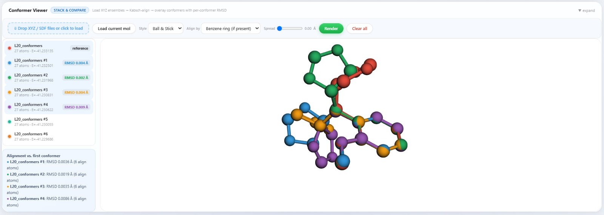

# DescriPyTor Tutorial

This tutorial is a guided path through the most common DescriPyTor workflow:

1. prepare molecular data
2. extract descriptors
3. assemble a feature matrix
4. inspect and reuse the saved results

If you want the short version, read the [README](../../README.md).

## Workflow at a glance



## What each module does

| Module | Role | Typical output |
| --- | --- | --- |
| `M1_pre_calculations` | Prepare external calculation inputs | input files and submission helpers |
| `M2_data_extractor` | Turn molecular files into descriptors | feature tables |

## Visual cues

Sterimol and ring-style descriptors are central ideas in the extractor layer, so here are two visuals already present in the repository:





## Path 1: start from feather files

This is the smoothest route when your molecular data has already been converted into `.feather` files.

### Step 1. Launch the GUI

```bash
python __main__.py gui
```

Use the GUI when you want to:

- inspect molecules before extracting descriptors
- choose atoms interactively
- save the extraction setup as JSON
- test several descriptor families quickly

Atom picking in the GUI:



### Step 2. Reuse a saved extraction config

The repository already includes a small example:

```bash
python __main__.py extractor \
  --input Getting_started_with_examples/input_example.json \
  --output feature_set \
  --feather_directory descripytor/examples/feather_example
```

Outputs typically include:

- a feature matrix CSV
- optional correlation summaries
- any plots configured by the extraction path

## Path 2: convert Gaussian logs first

If your raw inputs are Gaussian log files, convert them before feature extraction.



Run:

```bash
python __main__.py logs_to_feather
```

The command prompts for the directory containing log files and writes feather outputs for downstream extraction.

## Descriptor extraction in Python

If you prefer scripting instead of the GUI, follow the same pattern used in `Getting_started_with_examples/Practical_Notebook_Features.ipynb`:

```python
import os
import sys

ROOT_DIR = r"path	o\DescriPyTor"   # or leave unset and rely on DESCRIPYTOR_ROOT
sys.path.append(ROOT_DIR)
sys.path.append(os.path.join(ROOT_DIR, "M2_data_extractor"))
os.chdir(ROOT_DIR)

from data_extractor import Molecules
from descripytor.examples import feather_example_dir

feather_path = str(feather_example_dir())
mols = Molecules(feather_path)

# first inspect a structure, then build descriptor inputs
mols.visualize_molecules([0])
```

Once your atom selections are defined, the notebook workflow uses `get_molecules_features_set(...)` to save a feature matrix and correlation table.

## Conformer comparison and visual inspection

DescriPyTor also includes viewer-oriented utilities for comparing related structures and checking how conformers align in 3D. That is especially helpful when you are validating atom numbering, ring alignment, or ensemble consistency before extracting descriptors.

Conformer comparison view:




## Example notebooks

The best hands-on examples are already in the repository:

- [Getting_started_with_examples/Practical_Notebook_Features.ipynb](../Practical_Notebook_Features.ipynb)

## Troubleshooting

### The CLI help fails before showing usage

Check that your environment satisfies the pinned dependencies and that the scientific stack is installed correctly.

### Feature extraction fails on some molecules

Some batch extractors skip failures and continue. Start with a smaller example set to verify atom indexing and descriptor definitions.


## Suggested first session

If you are opening DescriPyTor for the first time, this is a good order:

1. Run `python __main__.py --help`
2. Open `Getting_started_with_examples/README.md`
3. Launch `python __main__.py gui`
4. Run the extractor example on `descripytor/examples/feather_example`
5. Open `descripytor feature_explorer` and draw the descriptors you extracted

That sequence gives you a feel for the whole stack.
