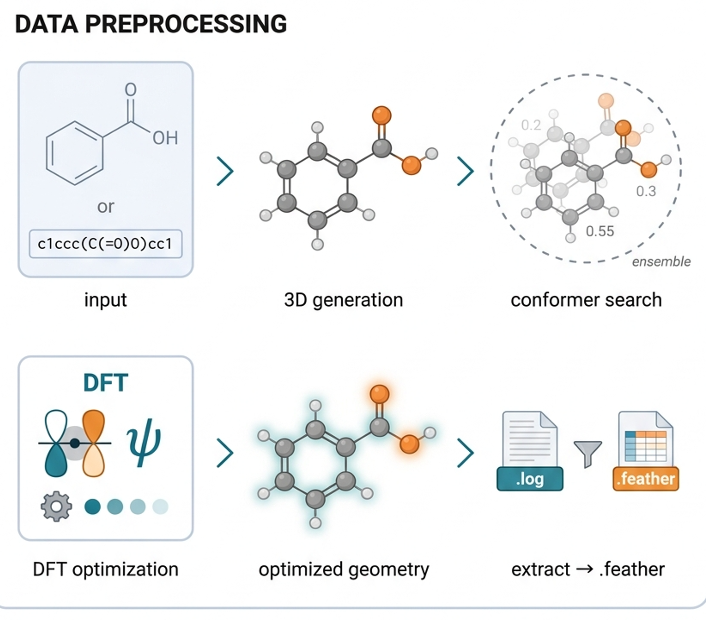
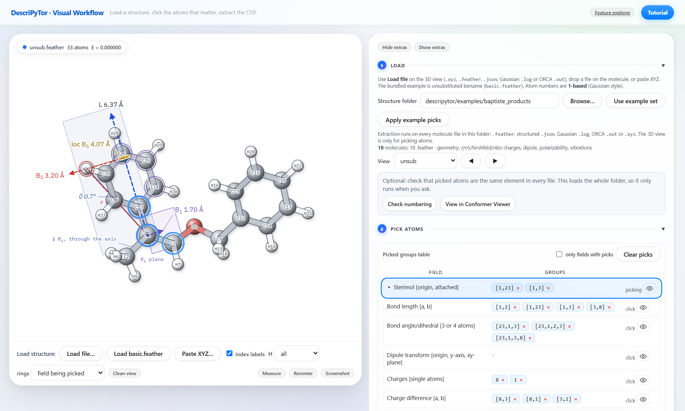
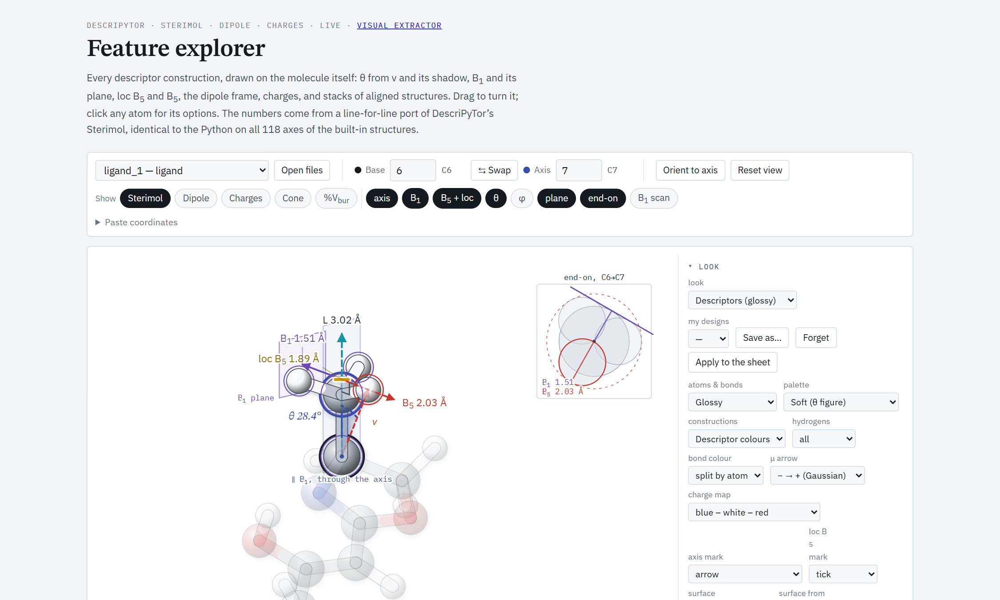
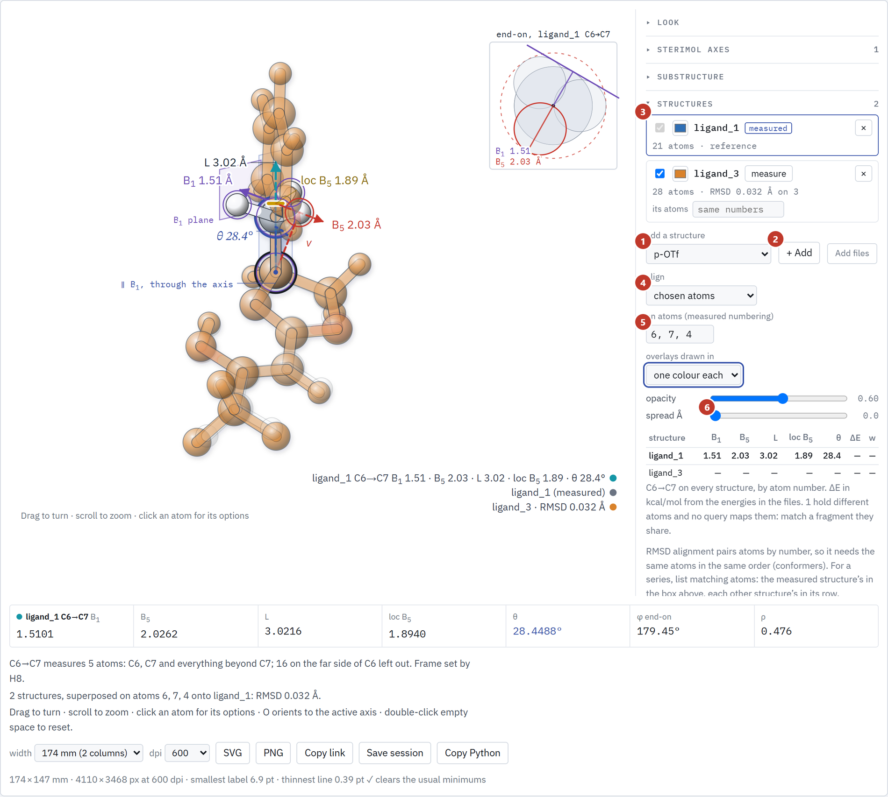
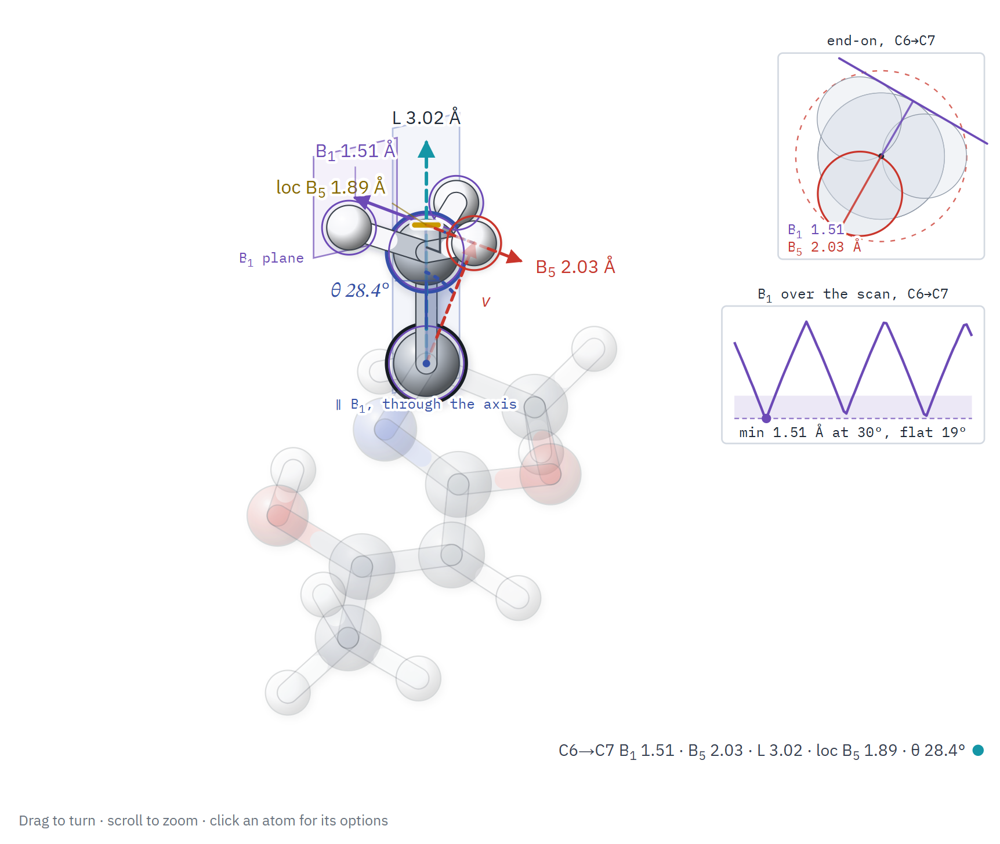

# DescriPyTor

**Pick the atoms that matter and extract descriptors you can interpret.**

DescriPyTor turns quantum-chemistry output (Gaussian, ORCA, xTB) into a feature table that you define atom by atom,
and draws every descriptor on the molecule so you can see where a number comes from.

Modeled after the R package *MoleculaR* ([docs](https://barkais.github.io/)).

<p align="center">
  <br>
  <em>Structure in, descriptors out.</em>
</p>

## Contents

- [Install](#install)
- [Five-minute tour](#five-minute-tour)
- [The two pages](#the-two-pages)
  - [Visual extractor](#1-visual-extractor) · [Feature explorer](#2-feature-explorer)
- [Command line](#command-line)
- [Python API](#python-api)
- [Descriptors](#descriptors)
- [From SMILES on a cluster](#from-smiles-on-a-cluster)
- [More tools](#more-tools)
- [Documentation](#documentation)
- [Repository layout](#repository-layout)

---

## Install

Python 3.9 to 3.11 (3.10 is what we test most). A conda environment is the easiest way to get RDKit.

```bash
conda create -n descripytor python=3.10 -y
conda activate descripytor
pip install descripytor
descripytor --help
```

From a clone (to change the code or run the tests):

```bash
git clone https://github.com/Milo-group/DescriPyTor.git
cd DescriPyTor
pip install -e ".[dev]"
pytest tests -q
```

Optional extra, added the same way (`pip install "descripytor[engines]"`, or `pip install -e ".[engines]"` from a clone):

| Extra | Unlocks |
|---|---|
| `engines` | mordred, deepchem, ase: extra descriptor engines |

If RDKit fails on pip: `conda install -c conda-forge rdkit`. `numpy<2` is required. Gaussian, ORCA, xTB and Open Babel
are external programs and are not installed by pip.

---

## Five-minute tour

Everything below runs on data that ships with the package.

```bash
descripytor visual_extractor
```

The page opens at <http://127.0.0.1:7432> with an example molecule. **Use example set** points it at the bundled
feathers; **Apply example picks** selects the atoms; **Extract CSV** computes the table for every molecule in the folder.

The same without a browser:

```bash
descripytor logs_to_feather                                        # Gaussian .log -> .feather (asks for the folder)
descripytor extractor -i input.json -o features -f feathers/       # the feature table
```

---

## The two pages

Each page is one command, opens in the browser, and links to the other in its header. Both draw molecules with the
same engine, the feature explorer, so a descriptor looks the same wherever you meet it.

| Page | Command | What it is for |
|---|---|---|
| **Visual extractor** | `descripytor visual_extractor` | pick atoms, extract the feature table for a folder |
| **Feature explorer** | `descripytor feature_explorer` | see any descriptor on the molecule, compare structures, make figures |

### 1. Visual extractor

```bash
descripytor visual_extractor                 # http://127.0.0.1:7432/visual
descripytor visual_extractor --port 8000 --no-browser
```

Load a `.xyz` or `.feather` (or drop it on the molecule), choose a descriptor field on the right, and click its atoms
in the figure. Pairs and triplets commit by themselves. Every selection is drawn as you make it: a Sterimol axis with
B<sub>1</sub>, B<sub>5</sub>, L and θ, the dipole in the frame you chose, a buried-volume sphere, and lengths, angles
and dihedrals with their values. Atom numbers are **1-based**, as in Gaussian.

<p align="center">
  <br>
  <em>Pick a field, click atoms, see the construction and its value.</em>
</p>

- **Extract CSV** runs the picks on every `.feather` in the folder; **Download CSV** saves the table.
- **Save picks** writes the input file that `descripytor extractor` replays on another set.
- **Check numbering** confirms the picked atoms are the same element in every file.
- Further down the page: a conformer viewer that overlays an ensemble with RMSD, and a vibration-mode player.
- **Tutorial** (top right) is a short walkthrough.

### 2. Feature explorer

```bash
descripytor feature_explorer                                         # http://127.0.0.1:7432/feature_explorer
descripytor feature_explorer --mol ligand_1 --preset "theta construction"
```

Every construction on the molecule itself: the Sterimol axis, the B<sub>1</sub> plane and its scan, loc B<sub>5</sub>,
θ, cone angle, %V<sub>bur</sub>, dipole frames, charges as sites or as a map, lengths and angles. Stack and superpose
several structures, each with its own descriptors; lay panels out on a sheet; export SVG or PNG. The numbers are
computed in the page by a line-for-line port of the Python, checked against it on every pick when the server is running.

<p align="center">
  <br>
  <em>The θ construction on a built-in structure.</em>
</p>

<p align="center">
   <br>
  <em>Left: stacked structures. Right: the B<sub>1</sub> scan around the axis.</em>
</p>

Open your own `.xyz`, `.sdf`, `.feather` or Gaussian `.log` with the file button; a feather or log brings the dipole
and the charges. A session (`.featurescene.json`) or an exported SVG reopens exactly as it was. Manual with every
control: [docs/FEATURE_EXPLORER.md](https://github.com/Milo-group/DescriPyTor/blob/main/docs/FEATURE_EXPLORER.md). Until October 2026 this page was called the Sterimol
theta explorer; `descripytor theta` and `/theta` still work.
Drawing molecules loads RDKit.js and fonts from the web, so the pages need an internet connection the first time
they open.

---

## Command line

```text
descripytor <command> [options]            descripytor --help            descripytor <command> --help

Pages
  visual_extractor   pick atoms on a molecule, extract descriptors for a folder                    (alias: visual)
  feature_explorer   draw any descriptor on the molecule                                           (alias: theta)

Batch
  extractor          descriptors for a folder of .feather files, from an input file of atom choices
  pipeline           SMILES -> structures -> chained cluster stages (GOAT / UMA / xTB / ORCA / Gaussian)

Converters (they ask for their inputs)
  logs_to_feather    Gaussian .log files -> .feather
  sterimol           Sterimol from .xyz files
  cube               Sterimol from Gaussian cube files
```

| Command | Options |
|---|---|
| `visual_extractor` | `--port` (7432), `--host`, `--no-browser` |
| `feature_explorer` | `--mol NAME`, `--preset NAME`, `--port`, `--host`, `--no-browser` |
| `extractor` | `-i input.json`, `-o output_name`, `-f feather_dir` |
| `pipeline` | `{build,adopt,submit,status,retry,reset,watch,fetch} protocol.json` and its flags ([docs/PIPELINE.md](https://github.com/Milo-group/DescriPyTor/blob/main/docs/PIPELINE.md)) |

Example:

```bash
# descriptors for the bundled benzenes, from the bundled atom choices (paths of a clone of this repository;
# after pip install, use your own input file and feather folder)
descripytor extractor -i descripytor/examples/feather_example/input_example.json \
                      -o feature_set -f descripytor/examples/feather_example
```

---

## Python API

Extract a feature table on the bundled set of 18 substrates:

```python
from M2_data_extractor.data_extractor import Molecules
from descripytor.examples import baptiste_example_dir

folder = baptiste_example_dir()
mols = Molecules(str(folder))                     # every .feather in the folder
features = mols.get_molecules_features_set({
    "Dipole": "23,24,25,26,27,28,23,1",           # origin atoms (ring centroid), y-axis atom, plane atom
    "Charges": "8,1",
    "Charge difference": "8,3 8,1 3,1",
    "Sterimol": "1,23 1,3",
    "Bond length": "1,2 1,23 1,3 3,8",
    "Bond angle": "23,1,3 23,1,2,3",              # three atoms: angle; four: dihedral
})
features.to_csv("features.csv")
```

One molecule, one descriptor at a time:

```python
mol = mols.molecules[0]
mol.get_sterimol([1, 23])                        # B1, B5, L, loc_B1, loc_B5, B1_B5_angle (theta), ...
mol.get_dipole_gaussian_df([[23, 24, 25, 26, 27, 28], 23, 1])
mol.get_charge_df([8, 1])                        # every charge type in the file
mol.get_bond_angle([[23, 1, 3], [23, 1, 2, 3]])
mol.get_stretch_vibration([1, 2])                # the pair must be bonded
mol.get_ring_vibrations([23])                    # one ring atom; ortho / meta / para are found
mols.get_sterimol_dict([[1, 23], [1, 3]])        # the same for every molecule, as one table
```

Metal complexes, from a single structure or a conformer ensemble ([docs/METAL_COMPLEX.md](https://github.com/Milo-group/DescriPyTor/blob/main/docs/METAL_COMPLEX.md)):

```python
from M2_data_extractor.metal_complex import MetalComplex, MetalComplexEnsemble

geo = MetalComplex.from_xyz("box_3_CuCl.xyz").geometric_features()
# fromM_* : Sterimol read from the metal; sub_* : from the stereocentre; bite, M-D distances, %Vbur, ...
ens = MetalComplexEnsemble.from_xyz("box_6.finalensemble.xyz").geometric_features()   # Boltzmann-averaged
```

Class reference: [M2_data_extractor/README.md](https://github.com/Milo-group/DescriPyTor/blob/main/M2_data_extractor/README.md).

---

## Descriptors

Most descriptor packages return thousands of columns. DescriPyTor asks which atoms matter and returns a few
descriptors you already understand, each read in a frame you define.

| Family | What you give it | What you get |
|---|---|---|
| **Sterimol** | `[origin, attached]` atom pair | `L`, `B1`, `B5`, where along the axis they sit (`loc_B1`, `loc_B5`), and θ, the angle between B<sub>1</sub> and B<sub>5</sub> |
| **Cube Sterimol** | a density `.cube` file | Sterimol from the electron density instead of tabulated radii |
| **Charges** | single atoms | NBO / Hirshfeld / CM5 values per atom |
| **Charge difference** | atom pair `[a, b]` | `q_a − q_b`, per charge scheme |
| **Dipole** | `[origin(s), y-axis, xy-plane]` | dipole components in your frame, and the total |
| **Bond length / angle** | pairs, triads or quartets | distances, angles, dihedrals |
| **Stretching vibration** | a bonded pair | frequency and amplitude of the mode along that bond |
| **Bending vibration** | two atoms sharing a centre | frequency and amplitude of the bending mode |
| **Ring vibration** | one ring atom | `cross` / `para` frequencies and angles of the ring |
| **Buried volume, cone angle, SASA, dispersion** | metal or apex atom | via morfeus |
| **Metal complex** | complex XYZ, optional xTB output | `fromM_*`, `sub_*`, %V<sub>bur</sub>, charges, bond orders, graph indices |

**A common frame.** Every molecule is rotated onto the same origin and axes, so "the dipole along y" means the same
thing in every row. You pick three groups: the origin is their centroid, ŷ points at the y-atom, and x̂ is the plane
atom with its ŷ part removed.

<p align="center">
  
</p>

**Sterimol.** `L` runs along the chosen bond; `B5` is the furthest reach from the axis; `B1` is the smallest width,
found by turning a tangent line all the way round the group.

<p align="center">
  
</p>

**Vibrations.** Each normal mode is scored by how much of its motion lies on the atoms you named; the best score
inside a frequency window is taken. Keep the window tight, or a C–H stretch can beat your carbonyl.

<p align="center">
  
</p>

What to decide and check at each step of an extraction: [docs/EXTRACTION_PROTOCOL.md](https://github.com/Milo-group/DescriPyTor/blob/main/docs/EXTRACTION_PROTOCOL.md).


---

## From SMILES on a cluster

`descripytor pipeline` takes a table of SMILES to numbered structures and chains conformer search and
quantum-chemistry stages (GOAT, UMA, xTB, ORCA, Gaussian) on an SGE cluster, one action at a time:

```bash
descripytor pipeline build  protocol.json        # SMILES -> numbered xyz
descripytor pipeline submit protocol.json --dry-run
descripytor pipeline status protocol.json
descripytor pipeline fetch  protocol.json
```

Protocol format and every flag: [docs/PIPELINE.md](https://github.com/Milo-group/DescriPyTor/blob/main/docs/PIPELINE.md).

---

## More tools

- **Other descriptor engines** in one pass (RDKit, Mordred, DeepChem, morfeus, AQME/xTB), merged into one CSV:
  [descriptor_extraction_toolkit/README.md](https://github.com/Milo-group/DescriPyTor/blob/main/Getting_started_with_examples/descriptor_extraction_toolkit/README.md).

---

## Documentation

| | |
|---|---|
| [QUICKSTART.md](https://github.com/Milo-group/DescriPyTor/blob/main/QUICKSTART.md) | one page: install and first run |
| [docs/WORKFLOW.md](https://github.com/Milo-group/DescriPyTor/blob/main/docs/WORKFLOW.md) | logs → features, with every option |
| [docs/EXTRACTION_PROTOCOL.md](https://github.com/Milo-group/DescriPyTor/blob/main/docs/EXTRACTION_PROTOCOL.md) | what to decide and check at each step of an extraction |
| [docs/FEATURE_EXPLORER.md](https://github.com/Milo-group/DescriPyTor/blob/main/docs/FEATURE_EXPLORER.md) | the feature explorer, control by control, with screenshots |
| [docs/METAL_COMPLEX.md](https://github.com/Milo-group/DescriPyTor/blob/main/docs/METAL_COMPLEX.md) | descriptors of metal complexes from GOAT / xTB output |
| [docs/PIPELINE.md](https://github.com/Milo-group/DescriPyTor/blob/main/docs/PIPELINE.md) | the cluster pipeline |
| [Getting_started_with_examples/](https://github.com/Milo-group/DescriPyTor/blob/main/Getting_started_with_examples/README.md) | notebooks for extraction, example data |
| [CHANGELOG.md](https://github.com/Milo-group/DescriPyTor/blob/main/CHANGELOG.md) | what changed, release by release |

Bundled data: 10 substituted benzenes (`descripytor.examples.feather_example_dir()`), 18 substrates with measured
outputs (`descripytor.examples.baptiste_example_dir()`), and density cubes for cube Sterimol.

---

## Repository layout

```text
descripytor/                    the installable package: the command line, examples
M1_pre_calculations/            structures and calculation inputs; pipeline/ (the cluster pipeline)
M2_data_extractor/              descriptor extraction: Molecules, Molecule, MetalComplex
  atom_picker.html                the visual extractor's page, served by gui_server.py
  feature_explorer/               the feature explorer: sources, build.py, and the gates that check it against the Python
utils/                          shared file handling, geometry, visualization
Getting_started_with_examples/  notebooks, example data, the multi-engine toolkit
docs/                           manuals, images, animations
tests/                          pytest suite and its data
```

Atom indices are **1-based** everywhere, matching Gaussian.

## License

MIT. See [LICENSE](https://github.com/Milo-group/DescriPyTor/blob/main/LICENSE).
