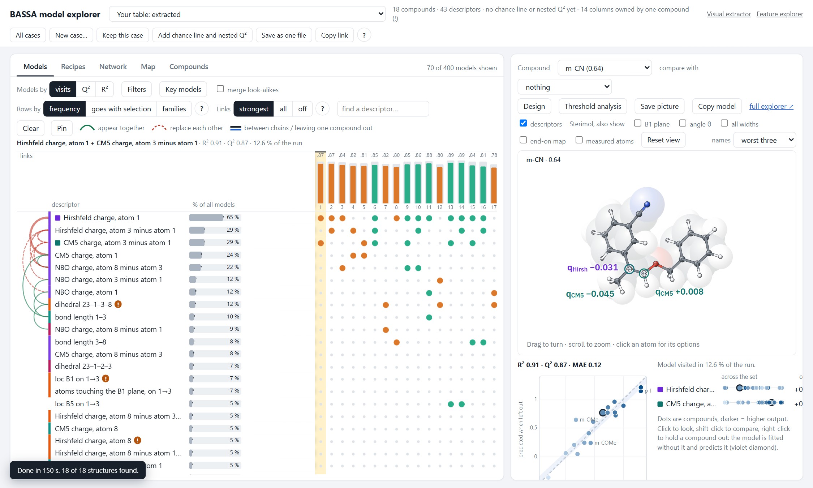
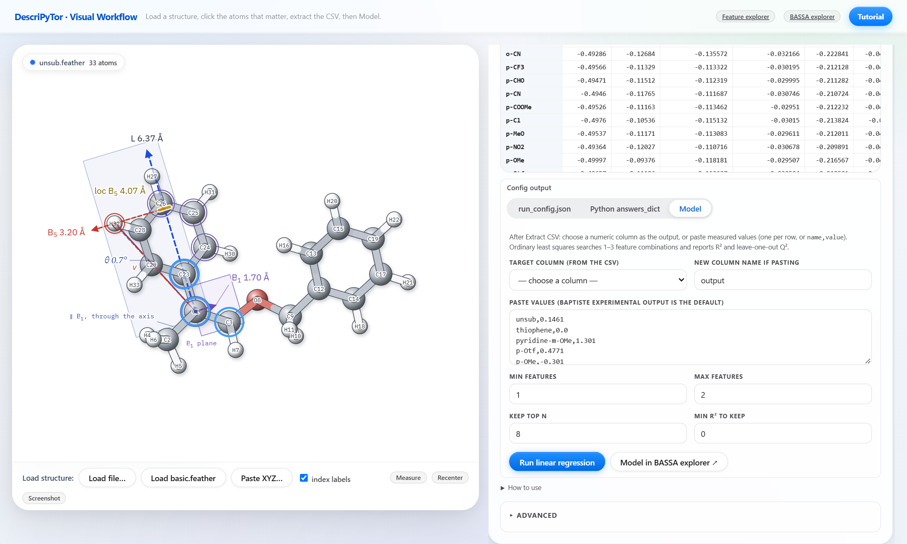

# BASSA model explorer

A page that puts BASSA's output beside the molecule. Columns are the models the sampler visited, rows are descriptors, and
the feature explorer on the right draws the selected descriptors on a compound of the set. It is a way of looking at a run,
not an analysis: nothing here changes a reported number.

## Start

    descripytor bassa_explorer

The page opens at http://127.0.0.1:8765/ with the example that comes with the package (17 ligands, 6 descriptors).
The molecule view is the package's [feature explorer](FEATURE_EXPLORER.md), framed in its figure mode.

| option | |
|---|---|
| `--cases DIR` | the folder where kept cases live; default `./bassa_cases`. Nothing is written inside the package |
| `--bassa-python PYTHON` | the Python that has `bassa_reg` (`pip install -U "bassa-reg>=0.1.16"`; an older one is reported by the page and left unused), for running new tables. Default: the Python that runs the command, or the environment variable `DESCRIPYTOR_BASSA_PYTHON` |
| `--port`, `--host`, `--no-browser` | as for the other pages; the default port is 8765 |

Without `bassa_reg` the page still opens the example and every kept case; **New case…** then says what is missing.
Structures (`.feather`, `.log`, `.xyz`) are always read by the Python that runs the command.

The sampler set-up is in `M3_modeler/bassa_explorer/`: `engine.py` (priors, chains) and `core_fixed.py`, a corrected copy
of the sampler core. The released core is wrong when descriptors are correlated; `BASSA_CORE=package` runs it anyway.

The other tools of the folder are scripts, run with the Python that has `bassa_reg` and `BASSA_EXPLORER_CASES` set to
the cases folder:

    python M3_modeler/bassa_explorer/batch.py <folder of csv> --response y [--structures FOLDER] [--checks]
    python M3_modeler/bassa_explorer/influence_check.py <case> [descriptor]
    python M3_modeler/bassa_explorer/build_case.py attach <case> <folder> ["title"] ["response"] ["unit"]
    python M3_modeler/bassa_explorer/build_case.py export [cases]      writes explorer_standalone.html in the cases folder
    python M3_modeler/bassa_explorer/test_page.py                      the page's click-through test, in headless Chrome
    (set BASSA_EXPLORER_CASES to the cases folder you use: without it the test sees only the bundled example case, and
     checks that need a validated case with an averaged model never run)

## From the visual extractor, in one click

In `descripytor visual_extractor`, after **Extract CSV**, open the **Model** tab, choose the target column or paste the
measured values, and press **Model in BASSA explorer**. The table, the target and the feather folder are handed over,
this page opens in a new tab and the run starts.

## Your own table

**New case…** in the page:

- a CSV whose first column is the compound name, with one response column and the descriptors;
- optionally a folder with one `.feather`, `.log` or `.xyz` per compound. A compound takes the file with its exact name,
  else one that contains its name as a whole word, else the only file that carries its number (`L1` and `FL_lig_1_str`).
  Feathers and logs bring charges and the dipole, xyz the geometry only;
- columns named as the DescriPyTor platform names them (`B1_6-4`, `loc_B5_6-4`, `nbo_atom_5`, `mu_y[C4->N5|C6]`,
  `0_angle_[5, 6, 7]`) are drawn on the molecule. Other columns work everywhere else.

A full run is three chains of 20,000 iterations. **Add chance line and nested Q²** then runs, in the background, 100
shuffles of the response and one rerun per compound left out. **Keep this case** writes it beside the page and adds it
to the menu.

## Reading a case

A case opens on the plain page: the views **Models**, **Recipes** and **Your families**, one column per combination of
families, the rows grouped by family, and only models of up to one descriptor per five compounds (rounded down);
**Filters** changes the sizes and the least share of visits. The plain page leads with BASSA's averaged model, validated
with the sampler rerun in every fold; the fit numbers of single models (R², Q², MAE) and their checks are under
**advanced**, because a model picked from the table was chosen on all compounds and those numbers flatter it. The **advanced** box
adds the rest (listed at the end of this section). A link made before the plain page existed opens in advanced.

- **How far to trust the case** (badges in the header, when the case file carries `evidence`): its rank among the paper's
  cases, whether the averaged model finds the best quarter of the compounds while they are left out, whether a model fitted
  without them still points to them (both pre-registered), and whether one compound carries the leading term (drop-one
  refits; "no term leads" when no descriptor is in half of the sampled models). Point at a badge for the numbers.
  `bassa_cases/attach_evidence.py` writes them from the design-test and drop-one results.
- **Which end is better**: a case file's `better` ("low" or "high"; otherwise read from the response text, e.g. "more
  negative = more selective"). Green bars, the threshold's default hits and "(better)/(worse)" follow it; a "lower is
  better" badge says so in the header.
- **Pointing at a point in the plot** opens a card: measured, predicted (left out), the 90 % interval, how far off and in
  which direction, and the three family parts that move it most. **All cases** also lists each case's design evidence
  (rank, finds the best, points past what it saw, drop-one, the better end).
- **Predictions as CSV** (Export): one row per compound (external ones marked): measured, predicted while left out
  (the averaged model's 5-fold, or the model in hand), the 90 % interval, the fitted value, and each family's part of it,
  the families that move the predictions most first; the parts add up to the fitted value.
- **Which end is better** can be turned round with the badge in the header (kept in this browser, per case): for a
  table of your own, set it once.
- **Copy link** now holds the whole view, also the averaged-model switch, the compounds you held out, design and the
  "why" drawing, and the family rule. **Keys**: / finds a descriptor; Esc closes a menu, then a comparison, then the
  selection; Ctrl+Z undoes a change to your families (also the Undo button there).
- **Print this case** (More): one page with the case's evidence, the averaged model, the plot, the compound in hand and
  what would make it better, to print or save as PDF. In the plot, points glide to their new places when the model changes.
- **Two compounds compared**: pick a **second compound** (or shift-click a second point). Under the molecule, the table
  "A → B: what changes" gives each family's part of the change (averaged model) or each descriptor's (the model in hand),
  the fitted change, the change predicted with both left out, and the measured change, with a mark when the left-out
  prediction moves the measured way. In the plot, a dashed arrow runs from the first compound to the second.
- **What would make a compound better** (one compound shown): the three families (or descriptors of the model in hand)
  whose part of its prediction could gain most if they took the best value any compound of the set has, that compound
  (click it), a strip of every compound's part (blue: this one, green: the best, better to the right), and how the
  family's lead descriptor differs between the two. A direction inside the measured range; the gains do not add up.
- **Design with the averaged model** (Design, when the plot shows the averaged model): start from a compound and move a
  slider per family (those with at least 2 % of the spread, five at most). A slider moves the family's lead descriptor;
  its look-alikes follow by their correlation with it. Beside it: the predicted value, the change from the starting
  compound with the typical miss, a bar from worse to better with every measured compound, the closest measured compound
  in these families, and a warning outside the measured range. The plot draws the prediction as a line.
- **Your candidates** (under the designer; Keep as candidate there, or Add from CSV: the name first, then columns named
  as in the case, a missing column set to the set's mean): each candidate priced by the averaged model, with a 90 % range
  (split-conformal, from the measured compounds' 5-fold errors), the gap to the best measured compound, the nearest one,
  and where it sits: among the measured, at the edge, a new combination (further from every measured compound, in what
  the model weighs, than the measured ones are from each other), past the measured range (a descriptor with ≥ 2 % of the
  weight), or too many columns missing (≥ 25 % of the weight). A strip places them among the measured compounds. Kept in
  this browser per case; Save as CSV writes them out. The CSV's numbers must be computed the way the case's were.
  **Add from a structure file** (only on a case that carries its recipe, see below) computes a new compound's columns
  from its own structure file by the recipe that made the case's.
- **Colour the plot by** any descriptor (the select over the plot); pointing at a row of the table colours it by that
  descriptor while the pointer stays.
- **What is left over** (under the molecule): each compound's error (measured − predicted while left out) against one
  family's part of the prediction, with a running mean and Spearman ρ. A trend means the model uses that family too
  much or too little.
- **Box selection** (mouse or pen; on a touch screen a finger scrolls the page): drag over the plot, then **Hold out**
  (adds the selected compounds to those already held out and refits; external compounds were never fitted and stay) or
  **On the molecule** (the first as the compound, the others compared with it); × clears it.
- **Jump to…** (Ctrl+K, or More): type part of a compound, descriptor, case or view name; Enter goes there. Esc closes it and changes nothing else.

- **The table**: a column is a model, a row a descriptor. Over each column: how often the sampler visited it, in % of
  its steps, which is also the height of its bar; under the bar, the 5-fold Q² (coloured: green ≥ 0.7, blue ≥ 0.4, amber
  above 0, red below) and the R² of that model kept fixed, which flatter it because it was chosen on all compounds; the
  most visited stand first (BASSA's own ranking). Click a
  column to draw its model; the arrow keys move along. **A column is** switches between a combination of families
  (models that differ only inside a family counted together, combinations under 1 % of sampled models left out) and a
  single model. A family counts as often as a model draws on it. The number under a column is its place. **?** in the header opens
  with **How this case is split**: which models are shown, the order, how the folds are dealt, and every family with
  the reason each member is in it.
- **Families**: descriptors that stand in for one another. A descriptor joins the most used descriptor for which its
  column is correlated at 0.7 or more, or at 0.5 or more when the sampler clearly takes one or the other; it never joins
  one the sampler uses it together with more than chance. The sampler's evidence is the 2x2 table of the two
  descriptors over the kept steps (log odds ratio, a tenth of the steps counted as independent, judged against the
  unrelated pairs of the same run). The "?" at the end of a row gives the reason with its numbers. **Families by** (beside
  "Fold families") switches the rule: **correlation** (the rule above, with the threshold |r| set between 0.6 and 0.8; the
  sampler clause then applies from 0.2 below it) or **sampler** (a descriptor joins when the sampler takes one or the
  other and the columns are correlated at 0.3 or more; never when the sampler uses the two together).
- **Ideas**: every family, and every descriptor on its own, has a letter and a colour (A is the most used). A family is
  a coloured block named after the descriptor the model in hand takes from it. It opens when that model uses it, shows
  its four most used descriptors, and keeps the rest behind **more**. **Fold families** leaves one row per idea.
- **Dots**: one per descriptor of the model. A hollow dot is used by another model of the same column; click it to swap
  it in. A folded family carries its dot on the heading. Lettered squares under a column name its ideas; a line joins
  its dots.
- **The mark under a column** (advanced; ! or ‼, none when nothing is flagged): how many checks flag the model. Counted: R² more than 0.15 above the
  leave-one-out Q²; a leave-one-out Q² within 0.05 when every descriptor is cut to high or low at its
  median (a switch, not a scale); the leading descriptor among the three most used in fewer than 80 % of the
  leave-one-out reruns. Shown and not counted: the ends of the range predicted from the rest, compounds beyond two
  standard deviations, and the leading descriptor against the chance line (the same for every model of a case, and
  said once as a pill beside the case name). The thresholds are choices, not calibrated.
- **The blue box above the plot**: BASSA's prediction for compounds it has not seen, the number to quote. Q² is the
  mean over the deals of the compounds into 5 folds (sampler rerun in every fold), with its range and the typical
  miss (MAE). The strip shows every deal as a blue dot and, when the case has a chance line, the same procedure on
  shuffled responses as grey dots; the line under it says how many deals beat every shuffle and the p of the mean
  (20 shuffles cannot give less than 0.048). A case where fewer than 90 % of the deals beat every shuffle is marked weak,
  and the pill beside the case name says "near chance". Then the share of held-out values inside the 90 % interval
  (not shown when the first-fold check failed: `cv.d_ok` false) and the compound furthest off, with Q² without it.
  The plot shows the same left-out predictions with their intervals. These come from the case file (`cv`;
  `cv.chance` and `cv.d_ok` are added by `attach_checks.py` in the cases folder). Every small **?** opens a drawing of that number.
- **Your families** (tab): make the families yourself, in three steps shown at the top (pick, add look-alikes, use them).
  The map places every descriptor so that look-alikes sit together (classical scaling of 1 − |r|): size is how often BASSA
  used it, colour your family (faint: the page's family, as a suggestion), lines from the one in hand to its look-alikes
  coloured by how the sampler treats the pair. Click a bubble to pick it, shift-click to put it in the family of the one
  in hand. Each family card carries its own small matrix of |r| with the sampler's verdicts; the matrix of every pair is
  folded at the bottom. Pick a descriptor (in the list, the map or a family): the page
  lists the twelve that look most like it, with their correlation and how the sampler treats the pair (in one model
  more than chance, one or the other, no preference, too rarely used to tell; judged as the page's own rule judges it),
  draws the two against each other with every compound coloured by the response, and draws both on the molecule.
  **+ add** puts a look-alike in the family of the descriptor in hand (or starts one with the two). Each family gives
  its share of models, the range of |r| inside it, where the page's rule differs, and a warning when two members are
  used together by the sampler (two ideas for BASSA) or hardly correlate. **Every pair** maps |r| for all pairs, with
  a red dot where the sampler takes one or the other and a green dot where it uses both, and frames your families.
  **Use my families in the table** makes the table, the recipes and the letters follow them; the validation numbers do
  not change, because the averaged model does not depend on the grouping. Your families are kept in this browser per
  case; **Save as CSV** writes them out.
- **Weights and equation**: under the plot, a bar per descriptor (its weight per standard deviation, ▲ raises and ▼
  lowers the response). **as an equation** unfolds the model on normalized descriptors, and in their own units.
- **Checks**: three chips for the counted checks (fit against test, a scale and not a switch, holds without one
  compound); hover one for its drawing, **all checks** for the list.
- **The plot shows: the averaged model / the model you clicked** (the switch over the plot, beside the blue box): the column you clicked instead of the averaged model: its fit (R², 5-fold Q², MAE, with its
  descriptors kept fixed, so they flatter it), its predictions in the plot, and its equation unfolded under the weights.
  It stays on while you click other columns. **Every weight of the averaged model** (folded under the model) lists the
  intercept and every coefficient, per standard deviation and per unit, with each descriptor's share of models; **save as CSV**.
- **One switch, Show the averaged model / the model you clicked**, sets what the plot, the molecule and the weight list
  show, together. A case opens on the averaged model; clicking a column shows that model everywhere (its numbers were
  chosen on all compounds, so they flatter it), and the line over the plot keeps the averaged model's Q², the number
  to quote. At a wide window the molecule sits beside the plot, the weights under the plot and the tabs under the
  molecule.
- **What drives the predictions** (a bar over the table, cases with an averaged model): one segment per family, as long
  as its share of how the averaged model's predictions differ from compound to compound (each family on its own; the
  families under 3 % share a grey end), named as in the table, with an arrow for whether a higher value of its most
  used descriptor predicts better (▲) or worse (▼). Point at a segment to mark its rows in the table; click it to draw
  the family on the molecule (click again to go back).
- **Ranked plot** (the switch over the plot: measured vs predicted / ranked): the compounds in the order the averaged
  model ranks them while each is left out, best first; dot measured, blue tick predicted, grey bar the 90 % interval.
  The shaded band is the model's top quarter, a green ring marks the measured best quarter, and the corner says how
  many of the best quarter the model's top quarter holds against chance (quarter²/n). Hover card, click, box
  selection and the designer's line work as in the other plot. The link keeps the choice (`pk`).
- **New here?** A first visit gets one line over the table; it opens the three steps.
- **Print this case** keeps the drive bar, opens the design tests, leaves out the controls and closed panels, and
  prints the colours as on screen; the right panel no longer jumps to a second page. A second compound opens the
  comparison tab; going back to the averaged model puts held-out compounds back (it is never refitted); a family is
  named by its most used descriptor everywhere; the ranked plot counts the best quarter rounded up, as the design
  test does; an uploaded table keeps its own families, candidates and better end even under a prepared case's name.
- **One model at a time**: every way of picking a column (a click on its head, the arrow keys, a hollow dot, a recipe,
  the jump box, Your families) shows that column in the plot, on the molecule and under the plot; holding a compound
  out on the averaged model moves to the column in hand first and says so, since only a fixed model can be refitted.
  Links also keep the colour, the tab beside the molecule and "More about this model".
- **Words for the chemist (18 Oct)**: the drive bar opens with one sentence, "The model expects better compounds
  with a higher X (share) and a lower Y (share)", with a caveat when Q² is under 0.4; the prediction line reads "How
  well it predicts new compounds: Q² (good ≥ 0.7, fair ≥ 0.4, weak) · off by ±MAE on average · better than chance";
  the switch reads "all models, averaged / the column you clicked"; the tabs "Why this prediction / How to make it
  better"; the plot "predicted vs measured / ranking". On the averaged model a family is named by its most used
  descriptor everywhere (table, bar, sentence). The Visual extractor and Feature explorer links are in More.
- **Simpler plain page (18 Oct)**: the header shows the case's rank, one "✓ n of n checks" pill that opens the design
  checks, and the better end; the table's head key is one short line (visits, Q², R²) with the rest under its ?;
  the line naming the column in hand and the order of the columns are advanced details; on the averaged model the
  weight list under the plot gives way to the bar over the table (every weight is one click away); what cannot be
  drawn on the molecule is one short line that opens; **More about this model** at the bottom holds Every weight,
  What is left over and How the number is made as tabs. The ranked plot carries its own key and one line on how to
  read it, and ties each prediction to its measured value.
- **Plain page, quieter**: the table's grouping and folding (A column is, Fold families, Families by, |r|) are in
  one **View** menu; Show, Design and Export share one row; in the plot only the compound in hand keeps a strong 90 %
  interval bar (the others are faint, all of them as before in advanced), and the class-mean ticks and the Sterimol
  axes on the molecule's label are advanced details.
- **The right panel** reads top to bottom: the prediction for unseen compounds in one line (Q², the typical miss and
  whether it beats chance; **how it was checked** opens the deals, the leave-one-out Q², the 90 % interval and the
  compound furthest off), the plot with the model in hand beside it, then the molecule with one panel at a time in
  tabs: **Why this value**, **What would make it better**, or **Compared** when a second compound is picked.
  The compound menus sit under the molecule (**Compound**, **vs** a second one); the menus name the compound only, its
  measured value is on the molecule. The model in hand shows each descriptor's effect as a bar and an arrow, its
  weight and the compound's value under the pointer (on the page in advanced). **Colour** over the plot opens the
  colour choice; the key beside it stays. The viewer's own hint shows while the pointer is on the molecule.
- **Why a compound is predicted where it is** (the first tab beside the molecule): the prediction for an
  average compound, then what each family adds for this compound (the four largest on the plain page, six in advanced; weight × its distance from the mean in standard
  deviations), the total fitted to every compound, and under it the left-out prediction and the measured value. With
  "the model you clicked" on the plot, the same per descriptor of that model.
- **Averaged model**: the average over every sampled model, on the molecule and as its five largest weights (`ens` in the
  case file). **Design**: a slider per descriptor
  (not on the averaged model). **Export**: the picture as SVG, or the model as text.
- **Recipes**: every model reduced to its families. A card leads with its share of sampled models, its letters and its
  5-fold Q² (coloured), with a small fit of its own (measured across, the card's models' 5-fold predictions up); click a descriptor to draw the model of that card that contains it,
  the arrows step through the card's models, and "together" is the card's models averaged by visits.
- **On the molecule**: Sterimol axes, charges and dipole components of the shown model, each with its value. A length, an
  angle or a dihedral is a dashed line through its atoms with the table's value (d, ∠, τ). **dipole arrow ×** and
  **Sterimol drawing** appear when the model has such a term. Untick **descriptors** to see the structures alone.
- **Layout**: drag the border between the two panels (double-click it to reset; the width is kept in the browser), and
  pull the corner of the molecule window (both ways) or of the plot to resize them (double-click the plot to reset it).
  The models table widens its descriptor names and its columns to fill the panel, and every part refits when a border moves.
- **Header**: **All cases**, **More** (new case, keep this case, add the chance line and leave-one-out reruns, save as
  one file, copy link), **Reaction**, and **?**.

What **advanced** adds:

- **Network**, **Map**: which descriptors share models (green) or stand in for each other (red). **Compounds**: for the
  ten most used descriptors, how the frequency moves when each compound is left out. A frequency that moves is the
  sampler changing its choice among near-equivalent models; check the coefficient before reading it as "the effect
  rests on that compound". `influence_check.py <case>` prints this for the leading descriptor.
- Over each column, the model's 5-fold Q² (with R² as the grey bar behind), as a fixed model; sorting the models by
  strength (that 5-fold Q²), Q² or R², and filters on Q² and R² (these use the leave-one-out Q², not the 5-fold one).
  Do not rank by Q²: that brings up large models the sampler hardly visited.
- Over the plot, the model in hand kept fixed (R², 5-fold Q², MAE), also while the averaged model is plotted; **Compare models** keeps one model as hollow marks beside a second; the checks on the model under the plot.
- Rows by frequency or by what goes with a selection; the links as arcs; pins; the count of merged models.
- Beside each descriptor, the leave-one-out reruns (top three, range); in family headings, the partner ideas and
  **on molecule**, which draws a family's descriptors together.
- Under the plot: where each descriptor's share goes without single compounds; **Threshold analysis**; point names.
- Right-click a point to leave a compound out of the fit shown; **Rerun BASSA without them** runs the sampler again.
- **Compare**: shift-click compounds in the plot to stack them, superposed on the atoms the descriptors name; every
  compound carries its own values in its own colour.
- A column the page cannot place on the molecule: click its name under the plot and say what it measures.
- The browser's Back button undoes the last selection.
- **All cases** (top right) is one table of every case, the ones validated over all the deals first, best Q² first:
  Q² of the averaged model with its range and typical miss, a strip of the deals against the shuffles, the chance verdict
  (above, weak, not above), the 90 % interval and the leading descriptor.
- The grey band around the chance line is how far the line could move with other shuffles. With 100 shuffles it is wide;
  `../bassa/null1000.py` computes it from 1,000 for a prepared case.

## A new compound from its structure file

**Add from a structure file**, in Your candidates, sends the file to `POST /featurize`. The server runs
`featurize.py` under the reader Python with the recipe that made the case's columns, which is stored in the case file as
`extraction`, and the compound lands as a candidate. Nothing is optimised and no xTB is run: the structure must be
computed the way the set's were. A file whose atoms cannot play the roles the columns assume is refused, and the reason
is shown. The values are rounded as the case's X was, so a measured compound added as new is priced at its fitted value.

| case | file(s) | how the atoms are matched |
|---|---|---|
| cs1_acids, cs1_acids_frames | Gaussian opt+freq `.log` (M06-2X/def2-TZVP, NBO, Hirshfeld, polar) | found from the bonds: the one aryl COOH |
| cs2, cs2_steric | Gaussian `.log` or its `.feather` | fixed numbering of the set (H21-O1-C2(-C17)=X3-C4(=N5-C6-C7)…), C6 of the set's configuration |
| cs3_cp, cs3_oa, cs3_cc, cs3_cc_sym, cs3_da_f | the GFN2 complex `.xyz` **and** its single point (`.txt`: the Q, W, D, E lines of `collect.sh`) | metal first, then its co-ligands, then the two donors; each arm needs a stereocentre |
| lucas_pdh2 | Gaussian opt+freq `.log` or its `.feather` of the (N,N)PdH2 complex | fixed PdMeCl v7 numbering, hydrides 13 and 14 |

The other cases have no recipe. wu_doyle reads three published numbers (vmin, %Vbur, cone angle) that no structure gives.
The recipe of `lucas_pdh2` runs scripts of the paper folder; `extraction.code` holds their hashes, and an edited script
stops the recipe until it is checked again.

A recipe is checked by re-extracting compounds of the case from their own files:

    <reader python> featurize.py check <case> <folder>      a folder of <name>.<suffix> (and <name>.txt for a companion)

It prints, per compound, the largest difference from the case's source table (`extraction.table`) and from the case's X.
On 18 October every measured compound of the ten cases above matched its source table to the table's own rounding
(at most 5e-7) and the case's X exactly. The two exceptions are in lucas_pdh2: LS1642 and LS1723 differ by 1e-4 in
nu_PdH_mean, on an exact half-tie at the 4th decimal that 1e-13 of float noise decides; this moves the prediction by
less than 1e-7 kcal/mol. External compounds kept with a different rounding (p-Me, the cs2_steric five) differ in the last digit.

## Structures for a case kept without them

    <anaconda python> build_case.py attach <case> <folder> ["title"] ["response label"] ["unit"]

Reads the folder as for a new case. A folder of metal complexes with two donors also gets the atom roles, so the
metal-referenced descriptors are drawn on both arms. Where the report has a chance line and nested Q² for a case of
that name, they replace the ones from the batch run.

## Many tables

    <BASSA venv python> batch.py <folder of csv> --response y [--structures FOLDER] [--checks]

Each CSV becomes a kept case. `--checks` adds the chance line, the nested Q² and the fold frequencies (a hundred more
runs per table).

## Prepared cases of the DescriPyTor paper

They are not in the package. `build_case.py models <case>` and `build_case.py page <case>` rebuild them from the paper's
folder (`BASSA_EXPLORER_PAPER`, and `BASSA_EXPLORER_CS2_FEATHERS` for cs2); to look at cases that already exist, point
`--cases` at the folder that holds their `.js` files and `manifest.js`.
