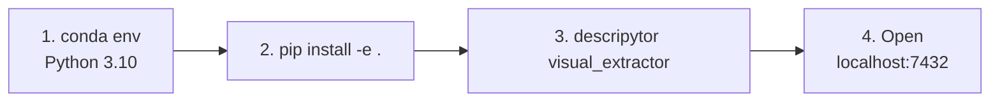
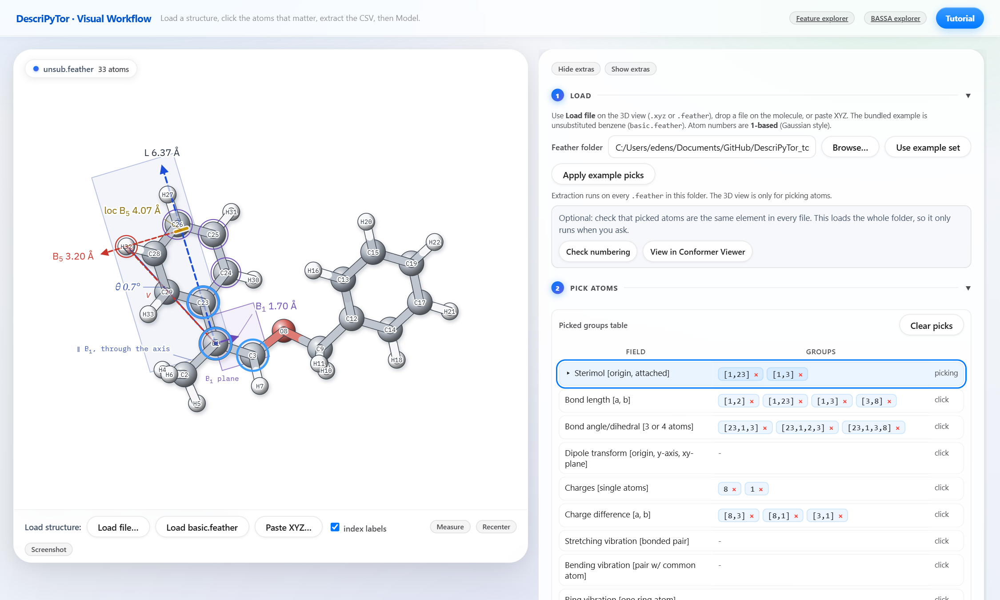
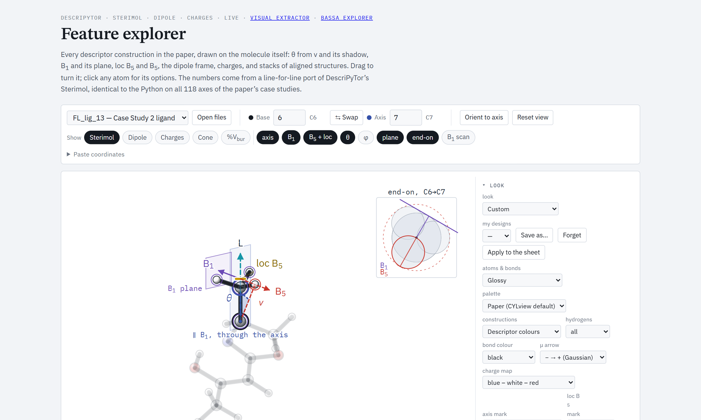
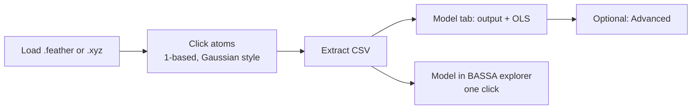

# DescriPyTor — visual start

Install with **conda + pip**, then open http://localhost:7432.

A printable page lives next to this file: [visual-guide.html](visual-guide.html) (open in a browser → Ctrl+P → Save as PDF).

---

## Install



```bash
git clone https://github.com/Milo-group/DescriPyTor.git
cd DescriPyTor
conda create -n descripytor python=3.10
conda activate descripytor
pip install -e .
descripytor visual_extractor
```

Then open **http://localhost:7432** (the 3D picker).

If RDKit fails: `conda install -c conda-forge rdkit`

---

## What you will see

| What | Open |
|---|---|
| Visual extractor: the 3D atom picker (start here) | http://localhost:7432 |
| Feature explorer: any descriptor drawn on the molecule | http://localhost:7432/feature_explorer |
| BASSA model explorer (`descripytor bassa_explorer`) | http://localhost:8765 |

The first three link to each other in their headers.

**Visual extractor** — an example molecule loads. Choose a descriptor on the right and click its atoms in the figure (1-based numbers); each pick is drawn with its value. Set the feather folder (or **Use example set**), then **Extract CSV**. The **Model** tab fits linear regression on a chosen or pasted output column, or sends the table to the BASSA model explorer in one click.



**Feature explorer** — the same drawing engine with every control: Sterimol, cone angle, %V_bur, dipole frames, charges, stacked structures, figure export. Manual: [FEATURE_EXPLORER.md](FEATURE_EXPLORER.md).



**BASSA model explorer** — the models a Bayesian search visited, beside the molecule. Manual: [BASSA_EXPLORER.md](BASSA_EXPLORER.md).


---

## In the picker



Example molecules (10 substituted benzenes) ship with the package. Gaussian `.log` files: convert first with `descripytor logs_to_feather`.

---

## If something fails

| What you see | What to do |
|---|---|
| RDKit / Morfeus import errors | `conda install -c conda-forge rdkit` |
| Port 7432 already in use | Close the other app using that port |

---

Longer notes: [QUICKSTART.md](../QUICKSTART.md) · [README.md](../README.md)
